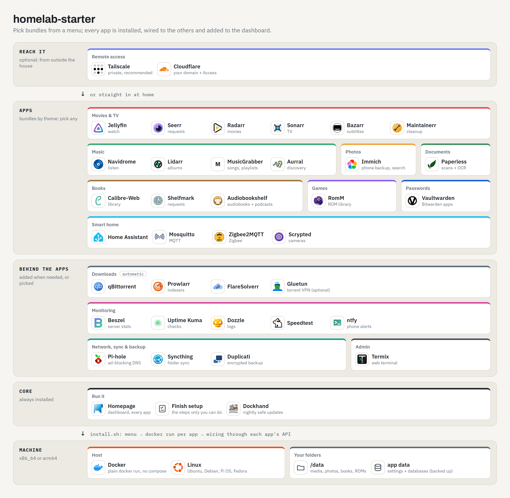

# homelab-starter

Turn a spare PC into a home server in one command. Pick what you want from a menu (movies & TV, music,
photos, books, games, smart home, passwords and more) and the installer sets up each app with Docker
**and wires them together for you**: the downloaders know about the indexers, the media server knows
about the libraries, the dashboard shows every app with its live stats.

```bash
curl -fsSL https://raw.githubusercontent.com/eoin18/homelab-starter/main/get.sh | sudo bash
```
Prefer to read it first? `git clone https://github.com/eoin18/homelab-starter && sudo ./homelab-starter/install.sh`

## What you get

<picture>
  <source media="(prefers-color-scheme: dark)" srcset="docs/diagram/starter-dark.png">
  
</picture>

When the installer finishes, open the dashboard. Anything that needs a human (signing in to Tailscale, choosing your indexers,
pairing a Zigbee stick) is listed on the **Finish setup** page with a link straight to the right screen.
Generated passwords are in `CREDENTIALS.txt` in your app-data folder (`sudo cat` it).

## Bundles

| Bundle | Apps | Needs |
|---|---|---|
| Core *(always)* | Homepage dashboard, Dockhand container manager with automatic updates, Finish-setup page | |
| Media server | Jellyfin | |
| Movies & TV | Radarr, Sonarr, Seerr (requests) | Media server, Downloads |
| Subtitles | Bazarr | Movies & TV |
| Media cleanup | Maintainerr | Movies & TV |
| Music | Lidarr (albums), Navidrome (streaming), MusicGrabber (songs/playlists), Aurral (discovery) | Downloads |
| Photos | Immich: phone backup with face and object search | |
| Books | Calibre-Web-Automated, Shelfmark (requests) | Downloads |
| Games | RomM: a web library for your ROMs (no downloader) | |
| Documents | Paperless-ngx: searchable archive with OCR | |
| Passwords | Vaultwarden (Bitwarden-compatible) | HTTPS: Tailscale or Cloudflare |
| Smart home | Home Assistant, Mosquitto | |
| Zigbee | Zigbee2MQTT | Smart home, a Zigbee coordinator |
| Cameras | Scrypted (cameras into HomeKit / Google Home / Alexa) | Smart home |
| DNS ad-blocking | Pi-hole | a DNS change on your router |
| File sync | Syncthing | |
| Backup | Duplicati: encrypted backups of app settings and databases | |
| Monitoring | Beszel, Dozzle, Uptime Kuma, Speedtest Tracker, ntfy (phone alerts) | |
| Admin tools | Termix: web terminal and file manager | |
| Remote: Tailscale *(recommended)* | private access from your own devices | a free Tailscale account |
| Remote: Cloudflare *(advanced)* | public URLs on your own domain behind Cloudflare Access | a domain on Cloudflare |

*Downloads* (qBittorrent, Prowlarr, FlareSolverr) is added automatically when a bundle needs it.
The menu shows what gets pulled in and an estimate of the RAM it will use.

## Good to know

- **Runs on** Ubuntu 22.04/24.04, Debian 12, Raspberry Pi OS 64-bit and Fedora, on x86_64 or arm64;
  any other Linux on a best-effort basis if Docker is already installed. A small Intel N100 box with 16 GB
  handles every bundle.
- **Your secrets stay yours.** Every password and API key is generated on your machine. Nothing is sent anywhere.
- **Safe to re-run.** Answers are saved to `config.env`; running the installer again recreates the containers
  but never overwrites your settings, passwords or data.
  `install.sh --add <bundle>`, `--remove <bundle>`, `--reconfigure`, `--status`, `--dry-run`.
- **Plain Docker, no compose.** Each app is one readable script in [`services/`](services); its wiring is in
  [`wire/`](wire). Data lives under `/data` (media) and the app-data folder you chose.
- **No download sources included.** You choose and configure your own indexers, and you are responsible for using them legally.

## Rebuilding your own server: profiles

A *profile* is a folder that describes one machine exactly: which bundles, plus any changes you made to
individual containers and any containers of your own. Keep it in git and a dead server comes back with
one command, no menus:

```bash
sudo ./install.sh --profile ~/myserver           # rebuild everything
./install.sh --render --profile ~/myserver       # print the exact docker run commands, change nothing
tools/profile.py capture --profile ~/myserver    # record what is running now into the profile
tools/profile.py diff --profile ~/myserver       # anything still different? ("no drift")
```

`capture` never writes a secret into the profile: it writes `${VAR}` and keeps the value in your secrets file.
Details in [docs/profiles.md](docs/profiles.md). The author's own server is rebuilt this way.

## More

- [DESIGN.md](DESIGN.md): how the installer works, bundle by bundle.
- [docs/profiles.md](docs/profiles.md): profiles, override files, capture.
- `tools/diagram.py`: draws the diagram above from [docs/diagram/starter.json](docs/diagram/starter.json) (app icons from [dashboard-icons](https://github.com/homarr-labs/dashboard-icons) and [selfh.st/icons](https://github.com/selfhst/icons)).
- [LICENSE](LICENSE)
